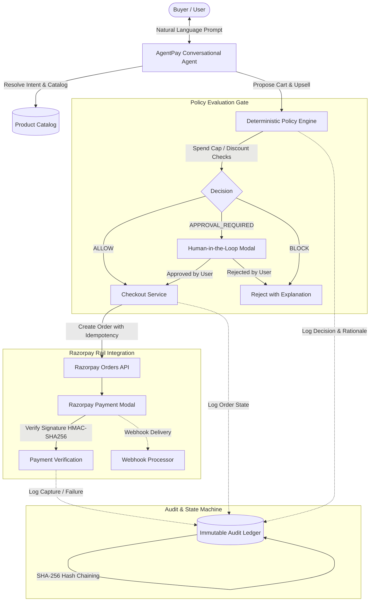

# AgentPay ⚡
### Trust & Policy Gateway for Autonomous Agentic Commerce on Razorpay

[](https://nextjs.org/)
[](https://react.dev/)
[](https://www.typescriptlang.org/)
[](https://www.prisma.io/)
[](https://razorpay.com/)
[](LICENSE)

**AgentPay** is an end-to-end trust and policy orchestration platform designed for autonomous AI agents engaging in digital commerce. Built directly on **Razorpay rails**, AgentPay guarantees **bounded autonomy**, **explainable decisioning**, **human-in-the-loop (HITL) approval governance**, and **cryptographically hash-chained audit trails**.

---

## 🌟 Key Highlights

- 🛡️ **Bounded Autonomy & Policy Gate**: Large Language Models (LLMs) **never touch payment credentials or execute direct money movements**. All financial actions must strictly pass a deterministic policy engine.
- 💬 **Conversational Agent with Entity Resolution**: Natural language product discovery, smart intent parsing, context-aware upsell recommendations, and multi-turn context tracking.
- ⛓️ **Cryptographically Linked Audit Ledger**: Every discovery, recommendation, policy evaluation, approval, and payment event generates a SHA-256 hash-chained immutable audit log.
- 💳 **Live Razorpay Test-Mode Integration**: Native Razorpay order creation, HMAC-SHA256 signature verification, and secure webhook processing with full idempotency protection.
- 🧑‍💻 **Human-in-the-Loop (HITL) Workflows**: Automatic escalation to merchant/buyer approval when transactions exceed autonomous spend limits, discount ceilings, or cross policy boundaries.
- 🔄 **Graceful Failure & Recovery**: Resilient state machine that detects payment declines and provides clear recovery/cancellation pathways without system deadlocks.

---

## 🏗️ System Architecture



---

## 🚀 Getting Started

### 1. Prerequisites

- **Node.js**: `v20.x` or higher
- **npm** / **yarn** / **pnpm**
- **Razorpay Test Account**: Key ID & Key Secret from [Razorpay Dashboard](https://dashboard.razorpay.com/)

### 2. Installation

Clone the repository and install dependencies:

```bash
git clone https://github.com/ArunTejaReddy02/potential-octo-bassoon.git
cd potential-octo-bassoon
npm install
```

### 3. Environment Variables Setup

Create a `.env` file in the root directory:

```env
# Database
DATABASE_URL="file:./dev.db"

# Razorpay Test Credentials
RAZORPAY_KEY_ID="rzp_test_YourKeyIdHere"
RAZORPAY_KEY_SECRET="YourRazorpayKeySecretHere"
RAZORPAY_WEBHOOK_SECRET="YourWebhookSecretHere"

# Next.js App URL
NEXT_PUBLIC_APP_URL="http://localhost:3000"
NEXT_PUBLIC_RAZORPAY_KEY_ID="rzp_test_YourKeyIdHere"

# AI Provider (Optional: Google Gemini for Live LLM Agent reasoning)
GOOGLE_GENERATIVE_AI_API_KEY="your_gemini_api_key"
```

### 4. Database Setup & Seeding

Initialize the SQLite database and seed initial catalog items and merchant policy baselines:

```bash
npx prisma migrate dev --name init
npx prisma db seed
```

### 5. Start Development Server

```bash
npm run dev
```

Open [http://localhost:3000](http://localhost:3000) in your browser.

---

## 🧪 Testing & Verification Scripts

The codebase includes test suites to verify policy gating, entity resolution, and security:

```bash
# Run conversational entity resolver tests
npx tsx scripts/test-conversational-context.ts

# Run end-to-end integration and policy checks
npx tsx scripts/test-integration.ts

# Run security, HMAC validation, and signature verification audits
npx tsx scripts/verify-security.ts
```

---

## 📡 API Reference Overview

| Endpoint | Method | Description |
| :--- | :--- | :--- |
| `/api/agent` | `POST` | Conversational buyer agent interface (intent parsing, catalog search, reasoning). |
| `/api/agent/catalog` | `GET` | Fetches active catalog with prices, stock levels, and discount ceilings. |
| `/api/agent/policies` | `GET` | Retrieves active merchant policy rules, spending caps, and approval rules. |
| `/api/policy` | `POST` | Deterministic policy evaluator (`ALLOW`, `APPROVAL_REQUIRED`, `BLOCK`). |
| `/api/checkout` | `POST` | Initiates Razorpay order creation with idempotency locks. |
| `/api/payment/verify` | `POST` | Verifies Razorpay payment signature via HMAC-SHA256 and captures order. |
| `/api/transactions` | `GET` | Lists recent transactions and audit event summaries. |
| `/api/transactions/[id]` | `GET` | Returns full transaction detail with complete hash-chained audit trace. |
| `/api/transactions/[id]/approve` | `POST` | Human-in-the-loop approval endpoint for gated transactions. |
| `/api/transactions/[id]/reject` | `POST` | Rejects held transaction and logs cancellation rationale. |
| `/api/webhooks/razorpay` | `POST` | Webhook receiver for Razorpay asynchronous payment events. |
| `/api/health` | `GET` | System health check and database connectivity monitor. |

---

## 🔒 Security & Compliance Principles

1. **Deterministic Execution Gate**:
   The AI reasoning agent only formats recommendations. Only the deterministic Policy Service can emit a signed approval token that unlocks order generation.
2. **Idempotent Order Creation**:
   Checkout requests enforce unique idempotency keys to eliminate double-billing or accidental re-execution.
3. **Cryptographic Integrity**:
   Audit logs use a strict sequential SHA-256 hash-chain:
   $$\text{hash}_n = \text{SHA256}(\text{hash}_{n-1} + \text{event\_id} + \text{action} + \text{payload} + \text{timestamp})$$
4. **Signature Verification**:
   All Razorpay payment verifications strictly recompute HMAC-SHA256 signatures server-side before state changes.

---

## 📄 License

This project is licensed under the [MIT License](LICENSE).
